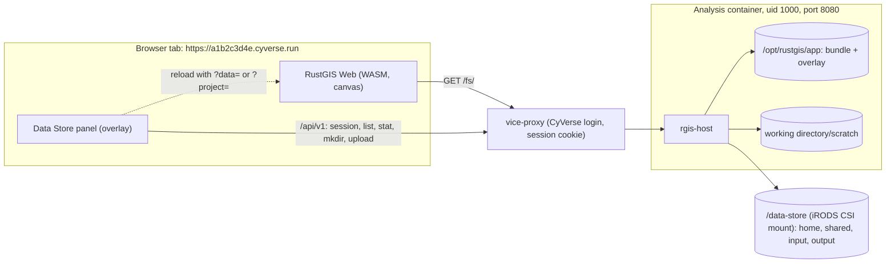

# MESA RustGIS — CyVerse VICE

[RustGIS](https://github.com/opengeos/RustGIS) Web, packaged as a stand-alone app for the [CyVerse Discovery Environment (VICE)](https://cyverse.org/discovery-environment), with the CyVerse Data Store as its file system. A Data Store panel sits over the map: browse your files, open them in place by URL, and upload from your computer.

  

Built from the unmodified `RustGIS-0.6.0-web.zip` release of [opengeos/RustGIS](https://github.com/opengeos/RustGIS) (tag `v0.6.0`), pinned by SHA-256 in [`UPSTREAM_REF`](UPSTREAM_REF).

## Status

| Milestone | Content | State |
| --- | --- | --- |
| M1 | Image from the release zip, `rgis-host` read path, guards, tests, smoke test, CI files | implemented |
| M2 | Measurements in the DE with a private tool | **pending**: see [`docs/verification.md`](docs/verification.md) |
| M3 | Data Store panel ("launch mode") and chunked upload | implemented, not yet run in the DE |
| M4 | Patched source build: in-app Open/Save against the Data Store ("bridge mode") | planned |
| M5 | Published image and public DE app, example data, portal listing | planned |
| M6 | Optional: preferences kept in the Data Store, autosave, auto-open of DE inputs | planned |

Nothing has been pushed to Harbor or registered in the DE yet. Everything this README says about the DE (mount layout, proxy behaviour, upload sizes) comes from reading sources and is marked unverified in [`docs/architecture.md`](docs/architecture.md) section 9 until M2 measures it.

## What's inside

| Part | What it is |
| --- | --- |
| **RustGIS Web** | The upstream v0.6.0 browser app: one Rust/egui WebAssembly binary drawing on a `<canvas>`. Unchanged, apart from one injected line in `index.html` that loads the overlay. |
| **`rgis-host`** | A small Go server (standard library only). It serves the app, serves Data Store files at `/fs/<path>` with byte-range support, and has a JSON API for listing, creating folders and resumable upload. |
| **Overlay** | `rustgis-host.js` and `rustgis-host.css`: the Data Store panel, plain DOM over the canvas, no framework and no build step. |

Base image: Ubuntu 24.04 with `tini`. The server runs as `rustgis` (uid 1000) on port 8080; working directory `/home/rustgis/data-store`. There is no nginx, no terminal, no iRODS client and no credentials in the image: the DE's iRODS CSI driver provides the Data Store mount.

## Architecture



- One container, one process, one port. `tini -g -- /opt/rustgis/bin/rgis-host`.
- RustGIS opens remote data only by absolute `http(s)` URL. The panel builds same-origin URLs of the form `https://<analysis host>/fs/iplant/home/<user>/dem.tif`, so formats that support range reads are read in place from the mount and never copied through the browser's local disk.
- In launch mode (the unpatched bundle) the panel cannot add a layer to the running map. "Open in new map" reloads the page with `?data=<url>` (up to 16) or `?project=<url>`, which upstream reads at start-up.
- Each analysis gets a new host name, and RustGIS projects store URL layers by absolute address. `GET /api/v1/project/<path>.rgis` therefore serves a project with stale `/fs/` origins rewritten to the current one.

The full contract (routes, JSON shapes, path rules, guard, headers, overlay behaviour) is [`docs/architecture.md`](docs/architecture.md).

## Run it

Build the image, make a fake Data Store, and run it the way the DE does (uid 1000, only `IPLANT_USER` and `REDIRECT_URL` set):

```bash
docker buildx build --platform linux/amd64 --load \
  --build-arg VERSION="$(cat VERSION)" \
  $(sed 's/^/--build-arg /' UPSTREAM_REF) \
  -t harbor.cyverse.org/vice/mesa-rustgis:latest latest/

ci/fixtures/make-data-store.sh /tmp/rgis-data-store   # user "rgistest"

docker run --rm --user 1000 -p 127.0.0.1:8080:8080 \
  -e IPLANT_USER=rgistest -e REDIRECT_URL=http://localhost:8080 \
  -v /tmp/rgis-data-store:/data-store \
  harbor.cyverse.org/vice/mesa-rustgis:latest
```

Then open <http://localhost:8080>. The [`Makefile`](Makefile) has targets for these steps.

- Publish the port on `127.0.0.1` only. `rgis-host` has no login of its own (in the DE, vice-proxy does that), so anyone who can reach the port can read and write the mounted directories.
- The file API answers only when the request's `Host` is the host of `REDIRECT_URL` / `RGIS_PUBLIC_URL`, an `RGIS_ALLOWED_HOSTS` entry, or `localhost` / `127.0.0.1` / `[::1]` (this is what stops a web page from reaching a local run by DNS rebinding). To open the app under another name or address, put that address in `RGIS_PUBLIC_URL`.
- The fixture directory must be writable by uid 1000 for uploads to work.
- With `--read-only`, mount a writable volume or tmpfs at `/home/rustgis/data-store`: the session scratch directory lives there.
- To use your own directory instead of the fixture, lay it out as `<dir>/iplant/home/<user>`, `<dir>/iplant/home/shared`, `<dir>/input`, `<dir>/output`. Missing directories are fine; they show as unavailable.

Configuration is by environment variable (`RGIS_*`); the table is in [`docs/architecture.md`](docs/architecture.md) section 1. The ones most likely to matter:

| Variable | Default | Use |
| --- | --- | --- |
| `RGIS_READONLY` | unset | `1` refuses every write (mkdir, upload). |
| `RGIS_USER` | `$IPLANT_USER` | Whose home directory is the `Home` root. |
| `RGIS_PUBLIC_URL` | `$REDIRECT_URL` | Public URL of the analysis; its scheme and host are used for the `Host` and `Origin` checks and for the project rewrite. |
| `RGIS_ALLOWED_HOSTS` | unset | Further `host[:port]` values to accept, comma-separated: for a gateway that changes `Host`. |
| `RGIS_MAX_CHUNK` | `8388608` | Largest upload chunk the server accepts. |

## Using the Data Store panel

The **Data Store** tab is on the right edge of the window. Click it to open the panel; `Esc`, the close button or a click outside closes it.

**Locations.** The top level lists five locations:

| Location | Path | Access |
| --- | --- | --- |
| Home | `/iplant/home/<you>` | read and write |
| Community Data | `/iplant/home/shared` | read only |
| Analysis Inputs | `/input` | read only |
| Analysis Outputs | `/output` | read and write |
| Session Scratch | `/scratch` | read and write; local to this analysis and gone when it ends |

A location that is not mounted is shown disabled. Names beginning with `.` and symbolic links are hidden and cannot be opened.

In the DE the app needs the launch option **Mount data store in analysis** left on (it is on by default). With it off there is no Data Store in the container: the panel says so, only Session Scratch works, and the DE copies the working directory, scratch included, to the analysis's output folder when it ends.

**Open data.** Tick up to 16 files and choose **Open in new map**. The page reloads with those files as layers. This replaces the current map; RustGIS asks first if it has unsaved changes. Use the browser's own modifier (Ctrl/⌘-click) to open the new map in another tab and keep the current one. For a Shapefile, tick the `.shp`: RustGIS fetches the `.dbf`, `.shx`, `.prj` and `.cpg` beside it itself, so ticking them too changes nothing, and one of them without its `.shp` cannot be opened.

**Open a project.** Tick one `.rgis` or `.rgispkg` file, alone, and choose **Open project** (or **Open in new map**, which does the same for a project). A project cannot be opened together with other files.

**Add a layer to the current map.** Tick one file, choose **Copy URL**, then in RustGIS use Add Data › From URL and paste. The URL works only inside this analysis, in this browser session; it is not a share link.

**Upload.** In a writable folder, choose **Upload** or drop files on the panel. Files go up in chunks (8 MiB at first, smaller if the gateway refuses that size) and each chunk is written straight to the Data Store. An interrupted upload resumes where it stopped if you choose the same file again in the same folder, even after the analysis's server restarted. If a file of that name exists you are asked before it is replaced. When the Data Store itself refuses a write, the panel reports "The Data Store refused or failed the operation (permission, quota or connection)": the mount does not tell the app which of the three it was.

**New folder.** Type a name and choose **New folder**.

**Save.** In this release RustGIS itself still saves and exports to your browser's Downloads folder. To keep a project or an export in the Data Store, save it, then upload the downloaded file with the panel. In-app Save to the Data Store is M4.

There is no delete, rename or move. Use the DE's Data window for those.

## Limits

These come from RustGIS Web, not from this image. The first group is from upstream's documentation and source as read for this project; consult the [RustGIS documentation](https://github.com/opengeos/RustGIS) for the release you run.

| Format | How it is read from the Data Store |
| --- | --- |
| Tiled GeoTIFF / COG (`.tif`, `.tiff`) | In place, by byte range: header first, then only the tiles in view. A multi-gigabyte COG is usable. |
| FlatGeobuf (`.fgb`) with a spatial index | In place, by byte range, a view at a time. |
| GeoParquet (`.parquet`, `.geoparquet`) with a bbox covering column | In place, by byte range, a view at a time. |
| PMTiles v3 | In place, a tile at a time. |
| Striped or otherwise untiled GeoTIFF; FlatGeobuf or GeoParquet without an index | Downloaded whole. |
| GeoJSON, CSV, GeoPackage, Shapefile, KML, GPX, LAS/LAZ and the other supported formats | Downloaded whole into browser memory, then parsed. |

- **256 MiB cap** on anything downloaded whole, projects included. Convert larger rasters to COG and larger vectors to FlatGeobuf or GeoParquet. The project route has the same cap (`RGIS_MAX_PROJECT`).
- **No JPEG 2000 and no GDAL-backed formats.** The browser build has no GDAL; those formats, DuckDB-backed sources, databases and File Geodatabase folders are desktop-only upstream.
- **16 files** per "Open in new map" (upstream's limit on `?data=`), and the resulting address must be at most 6000 characters.
- **Names with spaces or non-ASCII letters show encoded.** RustGIS names a layer or project opened by address from the address itself, so `my data.geojson` becomes the layer "my%20data" (rename it in the Layers panel). Names made of letters, digits, `-`, `_` and `.` read as written.
- **A saved project keeps a link only to layers read by range** (COG, FlatGeobuf and the like). Layers that were downloaded whole, such as GeoJSON or CSV, are copied into the project file and no longer follow the file in the Data Store.
- **Requests that stall for 30 s fail** in the app. A slow first read of a large file on the mount can hit this (to be measured in M2).
- **Browser state does not persist.** Every analysis has a new host name, so RustGIS preferences, saved connections and keys kept in browser storage start empty each launch.
- **Sign-in flows that return to the app with a `code` parameter do not work** (ArcGIS OAuth, for one): vice-proxy reserves that parameter.
- Uploads have no size limit from this service by default (`RGIS_MAX_UPLOAD=0`); the Data Store quota applies.

## DE tool settings

The definitions are in [`de/`](de/): `tool.json`, `app.json`, `app-readonly.json` and `app-docs.md`, with the Terrain calls in [`de/README.md`](de/README.md). These settings must match the image; change them only together with the Dockerfile.

| Setting | Value |
| --- | --- |
| DE app | **MESA RustGIS** (not registered yet) |
| DE tool | `mesa-rustgis`, version = the image tag (`0.6.0-1`) |
| Image | `harbor.cyverse.org/vice/mesa-rustgis:<VERSION>` |
| Type | interactive (`interactive: true`) |
| Network mode | `bridge` |
| Skip /tmp mount | `true` |
| VICE proxy | `interactive_apps` = cas-proxy block, as on the other MESA tools |
| Container port | **8080** (the only one) |
| Working directory | `/home/rustgis/data-store` (must match the Dockerfile `WORKDIR`) |
| UID | 1000 |
| Entrypoint override | none |
| CPU | 1 minimum, 2 maximum |
| Memory | 2 GiB minimum, 4 GiB limit |
| Disk | 10 GiB minimum |
| App parameters | none |

Registration steps:

1. Push the image for the version in `VERSION` to Harbor (CI does this on `main`).
2. Create the tool with Terrain directly: `POST /terrain/tools` with the body in `de/tool.json` (private tool), or `POST /terrain/admin/tools` for the public one. Do not use vice-app-integrator's Dockerfile validation for this image: it requires GoCommands, the GitHub CLI and Node.js, which this image leaves out on purpose.
3. Create the app from `de/app.json` (`POST /terrain/apps/de`), with `de/app-docs.md` as its documentation. It has no parameters.
4. Launch it privately, with **Mount data store in analysis** left on, and work through the M2 table in [`docs/verification.md`](docs/verification.md) before sharing or publishing it.
5. For a new image version, add a new tool version and a new app version labelled with the image tag; do not edit the existing ones.
6. After publishing, list it in the portal with `import_de_apps --name "MESA RustGIS"`.

A second, read-only app (`de/app-readonly.json`) is for analyses that will be shared: the same tool with `RGIS_READONLY=1`. Whether the DE delivers that variable to the container the way the file assumes is confirmed in M2; do not offer the app as read-only before then.

## Security model

In short; the full threat model is [`docs/security.md`](docs/security.md).

- **Login is vice-proxy's job.** `rgis-host` has no authentication. In the DE it is reachable only through vice-proxy, which admits the analysis owner and the users the analysis is shared with.
- **Same-origin only, on reads too.** vice-proxy answers CORS with credentials for every `*.cyverse.run` origin, so another analysis's page could otherwise read your files through your session. Every `/fs` and `/api` request is refused unless its `Host` is the app's own address and `Sec-Fetch-Site` and `Origin` say it comes from the app's own page. Writes also need a custom header and a non-form content type.
- **Confined paths.** Only the five locations above are reachable, each through its own `os.Root`. `..`, dot-files, symlinks (wherever they point) and non-regular files are refused.
- **Files are never rendered.** `/fs` responses are downloads (`Content-Disposition: attachment`, `nosniff`, `Content-Security-Policy: sandbox`) and never carry an HTML, SVG or XML type, so a file in the Data Store cannot run script in the app's origin.
- **No delete or rename.** The only destructive action is replacing a file by upload, which the panel asks about first. A folder is never replaced.
- **Sharing caveat.** vice-proxy forwards no user identity. Anyone the analysis is shared with acts as the owner: they can read everything the owner can under the five locations and can write to the owner's home and outputs. Share an analysis only with people you would give that access, or use the read-only app.
- **Read-only variant.** `RGIS_READONLY=1` refuses every write before it touches the file system.

## Build

The build context is `latest/`. `VERSION` and `UPSTREAM_REF` are passed as build args (see [Run it](#run-it)); the `Makefile` has targets for build, test, run and push.

The Dockerfile has three parts: a stage that downloads the release zip, checks its SHA-256, unpacks it and runs `inject.sh`; a `golang` stage that runs `go vet`, `go test` and builds `rgis-host`; and the Ubuntu runtime. `ARG RUSTGIS_SOURCE=zip` is the only supported value until M4.

The host's Go is not used. To run the server tests alone (`make test-server` does this with the Dockerfile's exact golang image, as root and as uid 1000):

```bash
docker run --rm -v "$PWD/latest/server:/src" -w /src golang:1.27.3 sh -c 'go vet ./... && go test ./...'
```

The image smoke test is `ci/test-cpu.sh`; what it checks, and the manual browser pass, are in [`docs/verification.md`](docs/verification.md).

**CI:** `.github/workflows/pr.yml` vets and tests the server, lints the Dockerfile and the scripts, checks that `de/*.json` name the version in `VERSION`, builds without pushing and runs the smoke test. `harbor.yml` builds on `main`, runs the smoke test, and pushes to Harbor only if it passes: `:latest` every time, `:<VERSION>` once. A published version tag is never moved, because DE tools pin it: `make push` (which CI also uses) pushes `:<VERSION>` only when Harbor answers "not found" for it, and fails rather than guess on any other answer. To publish a changed image, raise `VERSION` with `scripts/upstream.sh rebuild`. `security.yml` runs hadolint and a weekly trivy scan of `:latest` and of the tag in `VERSION`. The base images are pinned by digest, so the weekly rebuild only shows that the pinned build still reproduces; `.github/dependabot.yml` proposes new digests (and action versions) as pull requests. Pushing needs the `HARBOR_USERNAME` / `HARBOR_PASSWORD` repository secrets.

## Upstream tracking

RustGIS releases often. This repository follows release tags only, one at a time:

- `UPSTREAM_REF` pins the tag, its commit and the SHA-256 of the web zip. The build fails if the download does not match.
- `VERSION` is `<upstream version>-<n>`; `n` counts this repository's own releases on that upstream version. `scripts/upstream.sh bump` (new upstream release) and `rebuild` (same release, changed image) set it, in `VERSION` and in `de/*.json` together.
- The overlay depends on a few upstream behaviours (the `?data=` and `?project=` parameters, where upstream listens for keys). A bump re-checks them.

The procedure, and the planned M4 patch-series workflow, are in [`docs/upstream-updates.md`](docs/upstream-updates.md).

## Layout

```
latest/                         build context
  Dockerfile                    zip stage, Go stage, Ubuntu runtime
  inject.sh                     adds the overlay's two tags to index.html
  server/                       rgis-host (Go, standard library only) and its tests
  host/                         rustgis-host.js, rustgis-host.css (the overlay)
VERSION                         image version, <upstream>-<n>
UPSTREAM_REF                    upstream tag, commit, web-zip sha256
Makefile                        local build / test / run / push
scripts/upstream.sh             pin and version helper: bump, rebuild (M4 subcommands are stubs)
scripts/push.sh                 push :latest, and :<VERSION> only if it is not published yet
ci/test-cpu.sh                  image smoke test
ci/fixtures/make-data-store.sh  fake Data Store for local runs and CI
ci/fixtures/make-range-fixtures.sh  adds a COG and a FlatGeobuf to it (needs GDAL; browser pass)
de/                             DE tool and app definitions, app documentation, Terrain calls
docs/architecture.md            the binding contract: routes, guard, overlay
docs/security.md                threat model
docs/verification.md            local checklist and the in-DE measurement table
docs/upstream-updates.md        pinning and bump procedure
.github/workflows/              pr.yml, harbor.yml, security.yml
.github/dependabot.yml          base-image digest and action updates, as pull requests
```

## Roadmap

- **M2 — DE measurements.** Launch as a private tool and fill in the table in `docs/verification.md`: mount layout, proxy header behaviour, upload chunk size, append cost on the mount, time to first render of a large COG, session expiry, what a shared-with user can do. Adjust the design where a measurement disagrees with it.
- **M4 — bridge mode.** A small patch series against the pinned tag, behind a cargo feature, so RustGIS's own Open and Save dialogs use the Data Store and the panel can add layers to the current map without a reload. Needs a source build of the bundle. The overlay already detects the patched build (`window.rustgis_host_run`) and the Dockerfile has the `RUSTGIS_SOURCE` switch; neither does anything yet. The hooks will be proposed upstream.
- **M5 — publication.** Pinned image tag, example data, public DE app, portal listing.
- **M6 — optional.** Preferences kept in the Data Store, autosave, auto-open of DE input files.

## License and credits

Apache License 2.0; see [`LICENSE`](LICENSE) and [`NOTICE`](NOTICE). Copyright The MESA RustGIS App authors.

[RustGIS](https://github.com/opengeos/RustGIS) is developed by the opengeos community and is licensed under Apache-2.0. The image redistributes its release web bundle; the bundle's `LICENSE` and `THIRD-PARTY-LICENSES.txt` are kept in the image and served at `/LICENSE` and `/THIRD-PARTY-LICENSES.txt`. This project is not affiliated with or endorsed by RustGIS.

## Resources

- [RustGIS](https://github.com/opengeos/RustGIS) · [RustGIS Web](https://web.rustgis.app)
- [CyVerse VICE apps](https://learning.cyverse.org/vice/) · [Creating DE apps](https://learning.cyverse.org/de/create_apps/) · [MESA docs](https://idss-mesa.github.io/docs/)
- MESA org: <https://github.com/idss-mesa>
